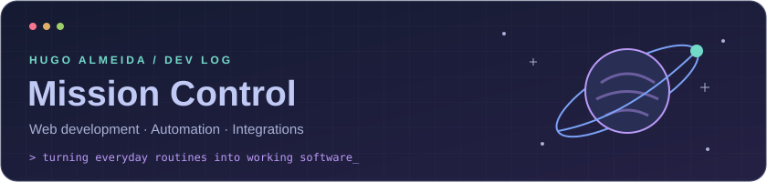
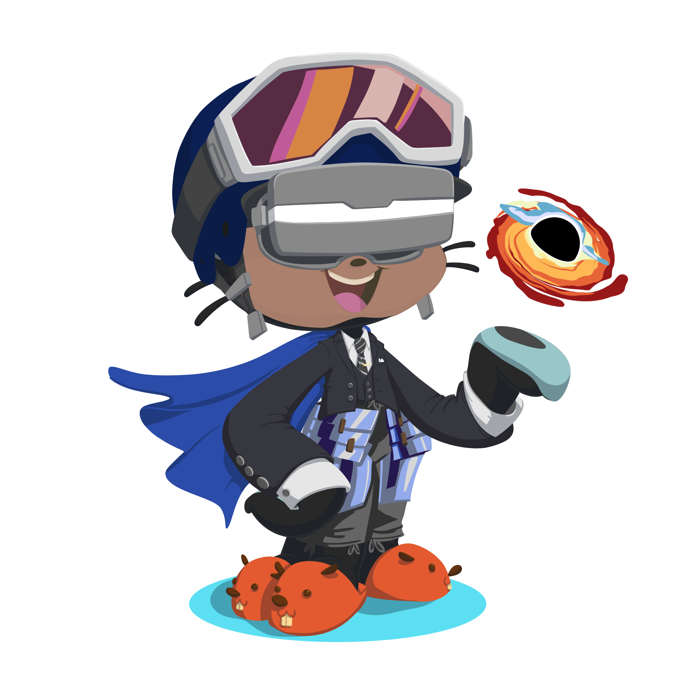

  

# Hi, I'm Hugo L. Almeida 👋

**Web development & process automation**

I build web applications and automations that connect systems and simplify accounting workflows.

Working at **Canella & Santos Contabilidade** · Based in **Rio de Janeiro, Brazil**

[LinkedIn](https://www.linkedin.com/in/hugo-l-almeida-023701221/) · [Email](mailto:hugogule@gmail.com)

 

> 🛰️ **Current mission:** connect systems, simplify routines, and give people a clear view of their work.

## 🚀 Main mission · Featured work

### Libby — Accounting Automation Platform

An internal platform I developed and use in daily work at **Canella & Santos Contabilidade** to organize accounting automations and follow their execution.

- **The workflow:** recurring accounting tasks involve Windows applications, spreadsheets, PDFs, and systems such as Domínio, Onvio, and Gestta.
- **What I built:** a web interface connected to a server and agents running on Windows VMs, with execution queues, scheduling, logs, and cancellation.
- **In daily use:** brings tools together in one place and makes execution progress, partial completion, and reconciliation differences visible for human review.

**Stack:** Python · FastAPI · PostgreSQL · Docker · Windows automation

_Private repository. Public demonstrations use fictional data._

## 🪐 Project orbit · Selected projects

### [Canella Ebook Library](https://github.com/Tsug07/canella_ebook_libby)

A web application for distributing ebooks through event QR codes and managing leads and content.

**Stack:** FastAPI · Jinja2 · PostgreSQL · Docker

### [DisBot Canella](https://github.com/Tsug07/DisBot_Canella)

Gerson, Rebecca, and Bip: bots that organize updates from systems, email, and spreadsheets and notify the team on Discord.

**Stack:** Python · discord.py · Google Sheets

### [PLID](https://github.com/hugolalmeida/PLID)

A web platform for organizational structure, people, meetings, tasks, and goals, with workspaces and access control.

**Stack:** Next.js · TypeScript · Supabase

🛠️ Open the hangar · More automation projects

- **C0ntrol:** a web system for managing debt-clearance certificates, with spreadsheet import and filtering.
- **MEG:** spreadsheet generation and processing tools using data matching and PDF extraction.
- **DomBots & AutoMessenger:** document-generation and communication automations for accounting processes.

## 🧰 Toolkit · Tools I use

- **Backend & integrations:** Python · FastAPI · API integrations
- **Web applications:** JavaScript · TypeScript · React · Next.js · HTML · CSS
- **Data & automation:** PostgreSQL · Supabase · Firebase · pandas · Selenium · Playwright · pywinauto · PDF processing
- **Delivery:** Docker · Git

## 📊 Flight log · GitHub stats

  
  

## 👨‍🚀 Behind the controls · A little about me

My background includes software development studies at **BYU–Idaho**. I enjoy connecting software development with the details of daily operations: clear inputs, visible progress, understandable results, and ways to handle exceptions.

**My approach:** understand the routine → connect the systems → build the workflow → learn from daily use.

## 📡 Open a channel · Let's connect

I'd be happy to talk about **automation, integrations, and web development**.

[LinkedIn](https://www.linkedin.com/in/hugo-l-almeida-023701221/) · [Email](mailto:hugogule@gmail.com) · [Portfolio (in development)](https://github.com/hugolalmeida/hugo-almeida-portfolio)
